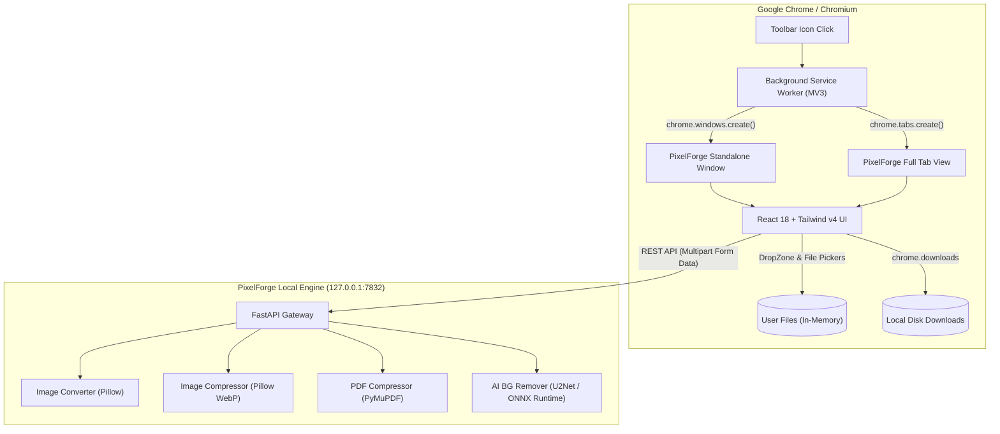

<div align="center">

# 🎨 PixelForge

### The Sovereign, 100% Offline Image & PDF Toolkit for Chromium

[](https://developer.chrome.com/docs/extensions/mv3/intro/)
[](https://react.dev/)
[](https://www.typescriptlang.org/)
[](https://fastapi.tiangolo.com/)
[](https://tailwindcss.com/)
[](#-privacy--security-by-design)

<p align="center">
  <b>Convert formats, compress images & PDFs, and remove backgrounds using local AI — without uploading a single byte to external servers.</b>
</p>

[Key Features](#-key-features) •
[Architecture](#-system-architecture) •
[Quickstart](#-quickstart) •
[Extension Loading](#-loading-the-extension) •
[API Reference](#-api-specification) •
[Privacy Guarantee](#-privacy--security-by-design)

---

</div>

## 💡 Why PixelForge?

Most online image and PDF converters require you to upload your sensitive documents and private photos to third-party cloud servers. They impose paywalls, limit file sizes, log telemetry, or degrade output quality.

**PixelForge changes the paradigm:**
- 🛡️ **Zero Cloud Dependencies:** Every computation (including state-of-the-art neural network background removal) runs locally on your machine.
- ⚡ **No Limits:** Process files of any size without subscriptions, usage quotas, or queue throttling.
- 🎯 **Pixel-Perfect Quality:** Fine-grained compression control and studio-grade alpha matting.
- 🪟 **Resilient Chromium UX:** Built with standalone window architecture to eliminate the notorious Chromium file-picker popup-dismissal issue.

---

## ✨ Key Features

### 🔄 Multi-Format Image Conversion
- Seamless conversion across **PNG, JPG, JPEG, and WebP**.
- Real-time quality sliders (1–100%) for lossy codecs.
- Instant file size differential calculation (`Before` vs `After`).

### 🗜️ Dual-Engine Compression
- **Images:** Leverages advanced WebP compression matrices for up to **80% size reduction** with negligible perceptual quality degradation.
- **PDFs:** Three compression tiers powered by PyMuPDF:
  - `Low`: Preserves archival print quality with minimal downsampling.
  - `Medium`: Balanced compression optimized for daily document sharing.
  - `High`: Maximum stream compression for tight email attachment constraints.

### ✂️ Neural Background Removal (Local AI)
- Built on the **U2Net Deep Saliency Detection** model via ONNX Runtime.
- **Alpha Matting Support:** Captures intricate edges such as fine strands of hair, fur, and translucent fabrics.
- **Mask Post-Processing:** Automated morphological filtering to eliminate contour artifacts.
- Interactive side-by-side **Original vs Result preview** on transparent alpha grids.

### 📦 Multi-File Batch Queue
- Drag-and-drop batches of images or documents.
- Unified operation selector (`Convert`, `Compress`, or `Remove Background`).
- Real-time per-file job progress indicators (`⏳ Pending`, `⚙️ Processing`, `✅ Done`, `❌ Error`).
- Staggered one-click **Download All** orchestration.

### 🗗 Flexible Dual-Display Modes
- **Compact Window Mode (Default):** Dedicated desktop popup window that remains active during native file picker interactions.
- **Full Tab Mode:** One-click expansion (`↗ Tab`) to full-screen view for expansive batch queues and large previews.

---

## 🏗️ System Architecture



---

## 🚀 Quickstart

### Prerequisites
- **Python:** Version 3.11 or later
- **Node.js:** Version 18.0 or later (with `npm`)
- **Browser:** Any Chromium browser (Google Chrome, Brave, Edge, Opera, Vivaldi)

---

### Option A: 1-Click Launch (Recommended)

Run the included unified launcher from the project root:

```bash
bash launch.sh
```

The script will automatically:
1. Verify the extension bundle build in `extension/dist/`.
2. Provision a dedicated Python virtual environment and install backend dependencies.
3. Start the local backend at `http://127.0.0.1:7832`.
4. Run health checks until ready.

---

### Option B: Manual Setup

#### 1. Setup Backend
```bash
cd backend
python3 -m venv .venv
source .venv/bin/activate
pip install -r requirements.txt
uvicorn main:app --host 127.0.0.1 --port 7832
```

#### 2. Build Extension
```bash
cd extension
npm install
npm run build:ext
```

---

## 🧩 Loading the Extension

1. Open your browser and navigate to:
   ```
   chrome://extensions/
   ```
2. Enable **Developer mode** via the toggle switch in the top-right corner.
3. Click the **Load unpacked** button.
4. Select the `extension/dist` directory:
   ```
   /path/to/pixelforge/extension/dist
   ```
5. Pin the **🎨 PixelForge** icon to your toolbar and click to launch!

---

## 📁 Repository Structure

```
pixelforge/
├── launch.sh                     # Unified one-command setup & launcher
├── README.md                     # Production product documentation
├── .gitignore                    # Comprehensive repository ignore rules
│
├── backend/                      # High-performance Python backend
│   ├── main.py                   # FastAPI server entrypoint & CORS config
│   ├── requirements.txt          # Python runtime dependencies
│   ├── start.sh                  # Automated venv provisioner and daemon
│   └── processors/               # Domain-specific image & PDF processors
│       ├── converter.py          # Format conversions (Pillow)
│       ├── compressor.py         # Lossy/lossless image & PyMuPDF compressors
│       └── bg_remover.py         # AI background segmentation (rembg / U2Net)
│
└── extension/                    # Manifest V3 Chromium Extension
    ├── index.html                # Single-page application host
    ├── package.json              # Node dependencies & build scripts
    ├── vite.config.ts            # Vite 6 bundler configuration
    ├── tsconfig.json             # TypeScript compiler settings
    ├── public/
    │   ├── manifest.json         # Extension Manifest V3 metadata
    │   ├── background.js         # Service worker handling window & download orchestration
    │   └── icons/                # High-res extension icons (16, 48, 128px)
    ├── scripts/
    │   └── post-build.mjs        # Production asset bundler for dist/
    └── src/
        ├── App.tsx               # Root view container & drag protection
        ├── api.ts                # Typed client API layer
        ├── index.css             # Design tokens, scrollbar styling, animations
        └── components/
            ├── Header.tsx        # View mode toggle (Compact / Tab) & branding
            ├── ServerStatus.tsx  # Dynamic backend connectivity monitor
            ├── TabBar.tsx        # Navigation tabs
            ├── DropZone.tsx      # Accessible drag-and-drop surface
            ├── ResultCard.tsx    # Conversion statistics & download prompt
            └── tabs/
                ├── ConvertTab.tsx    # Format conversion workbench
                ├── CompressTab.tsx   # Image and PDF compression workbench
                ├── RemoveBgTab.tsx   # AI segmentation workbench with checkerboard preview
                └── BatchTab.tsx      # Bulk processing pipeline
```

---

## 📡 API Specification

All endpoints are hosted locally at `http://127.0.0.1:7832` and accept `multipart/form-data`.

### `GET /health`
Verifies backend readiness.
```json
{
  "status": "ok",
  "service": "PixelForge API v1.0.0"
}
```

### `POST /convert`
Converts image format and tunes compression quality.
- **Parameters:**
  - `file`: Binary file stream
  - `format`: `png` | `jpg` | `jpeg` | `webp`
  - `quality`: Integer `[1, 100]` (default: `90`)
- **Returns:** Converted image binary.

### `POST /compress/image`
Compresses image into optimized WebP.
- **Parameters:**
  - `file`: Binary file stream
  - `quality`: Integer `[1, 100]` (default: `75`)
- **Returns:** Compressed WebP binary.

### `POST /compress/pdf`
Compresses PDF content streams and embedded assets.
- **Parameters:**
  - `file`: PDF file stream
  - `level`: Integer `1` (Low), `2` (Medium), `3` (High)
- **Returns:** Compressed PDF document binary.

### `POST /remove-background`
Extracts foreground subject with transparent alpha channel.
- **Parameters:**
  - `file`: Binary file stream
  - `alpha_matting`: Boolean (default: `true`)
  - `post_process`: Boolean (default: `true`)
- **Returns:** Transparent PNG binary.

---

## 🔒 Privacy & Security by Design

PixelForge was architected from line one with strict data sovereignty:

| Principle | Implementation |
|---|---|
| **Zero Network Leakage** | All processing occurs over local loopback (`127.0.0.1`). No outbound requests to external cloud services are ever initiated. |
| **No Persistent File Storage** | Files are buffered in memory and processed as ephemeral streams. No user documents or images are retained on disk by the backend. |
| **Air-Gapped AI** | The U2Net model weights run on-device via ONNX Runtime without phone-home telemetry. |
| **Minimal Permissions** | The extension only requests `storage`, `downloads`, and `tabs` permissions necessary for window management and saving your files. |

---

## 📜 License

Distributed under the **MIT License**. Free for personal and commercial use.
See [LICENSE](LICENSE) for details.
